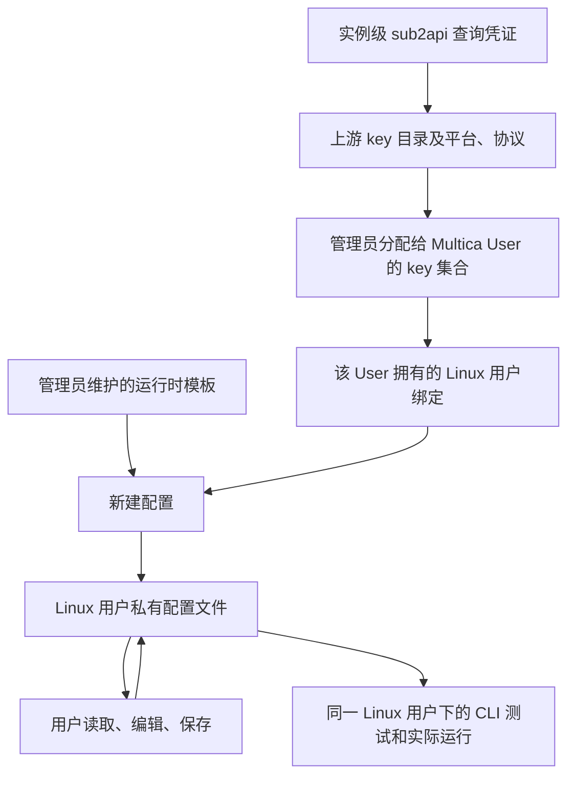

# Linux 用户运行时模型配置方案

状态：首版实现已于 2026-10-09 随 `b7c9645c6` 部署，镜像、迁移与上线验证见[部署记录](../engineering/runtime-model-configuration-deployment.md)。真实 sub2api resolve 和模型探测已在实现阶段验证，目录元数据扩展和目标 CLI 版本仍需联调验收；本次部署未执行真实 CLI 模型调用。sub2api 所需扩展见[接口契约](sub2api-key-directory-contract.md)。

## 1. 目标与确认结论

管理员统一接入 sub2api、维护运行时模板并分配 API key。Multica 用户在 "我的 Linux 用户" 中选择 key、查看和编辑完整配置、保存到自己的 Linux 账号，再用实际 CLI 测试模型连接，无需 SSH 登录完成这些操作。

| 项目 | 已确认的行为 |
| --- | --- |
| 上游账号 | 所有待分配 key 都属于同一个 sub2api 用户；Multica 只保存一份该账号的查询凭证，不为每个 Multica User 保存查询凭证。 |
| key 分配 | 实例管理员为每个 Multica User 分配多把 key；列表和选择器支持搜索、过滤。 |
| 适用运行时 | Multica 根据 sub2api 的 `platform` / `protocols` 与 runtime 支持协议计算兼容范围，不再要求逐 key 的 runtime 限制；仍校验管理员的 User-key 分配。 |
| 默认选择 | 每个 Linux 用户的每种运行时通常使用一把 key；首次配置默认选择稳定分配顺序中的第一把可用且适配的 key，用户可下拉切换。 |
| 模板 | 每种运行时对应一个模板，可包含多个配置文件的位置、格式和内容；仅实例管理员维护。 |
| 模板生效范围 | 模板只用于新建配置。模板更新不覆盖已有配置；用户修改自己的文件不修改模板。 |
| 配置编辑 | 用户能查看完整文件及明文模型 key，编辑、保存和测试自己的配置。 |
| 持久化 | 允许将模型 key 长期保存到对应 Linux 用户的私有配置文件。 |
| 安装后处理 | CLI 安装成功后，配置尚不存在时自动尝试初始化；安装、配置、测试分别报告结果。 |
| 测试 | 提供不调用模型的 "检查配置" 和通过实际 CLI 发起最小请求的 "测试模型连接"。 |
| 批量操作 | 单项安装或配置失败不影响后续项；沿用现有对远端状态未知情况的保护，先确认终态，避免并发重入。 |

首期覆盖受管 Linux 账号中的 Claude、Codex、OpenCode、OpenClaw、Grok、Kimi、OMP、Pi。提供八种可编辑默认模板；配置状态默认未测试，只有目标 CLI 返回有效回复后才标记测试通过。OpenClaw 支持发现已安装的 CLI 和配置管理，本次不新增其安装器。Web 和 Desktop 使用相同共享页面；移动端、非受管个人电脑及模型代理不在本期范围。

## 2. 资源归属和权限



| 资源 / 操作 | 实例管理员 | Linux 账号所有者 | 其他工作区成员 |
| --- | --- | --- | --- |
| 查询服务地址、查询凭证 | 配置、替换、验证；保存后不回显查询凭证明文 | 无权读取 | 无权读取 |
| 上游完整 key 目录 | 查询、搜索、刷新，不批量 resolve token | 仅查看分配给自己的目录子集 | 无权读取 |
| User 的 key 分配 | 增删分配、排序；展示计算出的兼容运行时 | 查看自己的分配 | 无权管理 |
| 运行时模板 | 编辑、校验、发布修订 | 用于新建配置，不能修改模板 | 无权修改 |
| Linux 用户实际配置 | 管理身份本身不增加读取他人私有文件的权限 | 读取明文、编辑、保存、测试 | 无权读取或修改 |
| 操作与测试记录 | 查看脱敏运维记录 | 查看本人脱敏记录 | 不因工作区成员身份获得访问权 |

管理员也可作为自己 Linux 账号的所有者使用用户侧功能。本期不新增管理员读取他人完整配置的入口，沿用现有凭据读写的所有权边界。

关键身份规则：

- 分配的作用域是 Multica User，不是工作区。实际配置的作用域是 `(computer_binding_id, runtime_kind)`，同一 User 的不同 Linux 账号分别保存配置，不自动相互覆盖。
- `runtime_kind` 使用 CLI 注册表中的稳定种类标识，例如 `codex`；它不是 daemon 注册出的运行时 UUID。
- 用户侧请求通过已有绑定加载器验证所有权、已验证状态、可操作状态，再从绑定解析 Computer、Linux 用户和 home。客户端不能指定任意用户名、home 或 SSH 目标。
- 工作区共享运行时不授予其他成员读取配置的权限。任务使用被选运行时所属 Linux 账号的模型凭据；共享者需知道模型用量可能记到运行时所有者对应的 key。
- 计算出的兼容运行时是 Multica 分配和配置流程中的强制约束。用户获准查看明文并任意编辑自己的配置，Multica 不能阻止其在系统外复制使用 key；上游调用限制和额度仍由 sub2api 执行。

## 3. 页面与交互

### 3.1 Admin Area

不新建工作区级凭据体系。在 Admin Area 增加模型凭据来源、用户分配和运行时模板管理入口，复用现有实例管理员鉴权。

| 页面 | 主要内容 | 操作 |
| --- | --- | --- |
| 模型凭据来源 | sub2api 地址、凭据已配置状态、目录验证时间、最近错误 | 保存地址和凭据、验证目录、刷新目录 |
| 用户详情 → 模型 API key | 名称、上游 ID、状态、适用运行时、分配顺序 | 搜索添加、多选分配、移除、调整顺序 |
| 运行时模板 | 运行时、修订、文件数量、支持协议、验证状态 | 编辑文件定义和内容、预览占位示例、校验、保存 |

适用运行时由 Multica 根据上游目录返回的 `platform` 与 `protocols`，以及 runtime 自身支持的协议计算。管理员仍通过分配列表决定用户可以使用哪些 key；目录元数据不完整或协议不兼容时明确显示配置异常，不能默认允许所有 runtime。

搜索按 key 名称和上游 ID，页面支持运行时过滤，并显示 key 状态；目录 API 另支持状态过滤。目录超过 100 条时正确跨页检索；不能只搜索第一页。默认项依据管理员保存的分配顺序，不依据搜索结果或上游响应顺序。

### 3.2 我的 Linux 用户

运行时表格增加模型配置入口，并将安装状态与模型配置状态分开：

| 运行时 | CLI 版本 / 安装状态 | API key 名称 | 默认模型 | 配置状态 | 最近测试 | 操作 |
| --- | --- | --- | --- | --- | --- | --- |
| Codex | 已安装 | team-codex | 示例模型 ID | 已配置 | 成功 / 时间 | 模型配置、安装或更新 |
| Kimi | 已安装 | — | — | 未分配可用 key | 未测试 | 模型配置 |

打开模型配置后，显示 Computer、Linux 用户和运行时，避免误改账号。包含：

- 带搜索的 key 下拉框：仅本人已分配、启用、允许此运行时的 key；重名时显示上游 ID。
- 模型下拉框：由所选 key、运行时限制和协议交集过滤；无默认模型时要求明确选择，不能猜测模型名称。
- 文件列表：路径、格式、是否存在；选中文件后显示完整编辑器。敏感内容只在用户主动读取后加载，普通资产列表不加载文件。
- "检查配置"、"保存"、"测试模型连接"；存在未保存修改时提供 "保存并测试"。
- 测试结果：运行时版本、模型、目标主机名、所用配置修订、耗时、结果与脱敏错误复制。测试按钮旁明确可能产生模型费用。

编辑器允许查看完整 key，提供明确的复制文件动作；操作记录中的错误复制始终脱敏。表格与编辑器处理长路径、长名称和横向溢出，保留标签、键盘操作、选中状态以及加载和错误反馈。

### 3.3 保存与选择的关系

| 用户动作 | 草稿变化 | 远端文件变化 |
| --- | --- | --- |
| 新建配置 | 使用当前模板和所选 key / 模型生成草稿 | 仅保存后写入；安装后的首次自动初始化除外 |
| 切换 key / 模型 | 适配器在当前文件内容上修改连接、认证、模型相关字段，显示差异 | 未保存时不变 |
| 手动编辑文件 | 编辑当前草稿 | 未保存时不变 |
| 保存 | 校验并提交所有变更文件 | 写入成功后才更新页面状态 |
| 更新管理员模板 | 当前草稿和已有配置不变 | 不变 |
| 测试模型连接 | 不隐式保存草稿 | 使用已经保存的配置 |

已有配置切换 key / 模型使用结构化字段修改，不重新渲染管理员模板。保留用户的 MCP、权限、插件、其他 provider 和无关字段；格式不支持或无法确定修改位置时报告冲突，允许用户手工编辑，不做整文件盲目替换。

用户手工修改了模型或 key 后，无法可靠确认目录身份时显示 "自定义配置"，不得继续声称它使用原分配 key。数据库中的选择记录仅用于辅助展示，实际文件是执行依据。

## 4. 模板与运行时适配器

模板定义一组文件，建议字段为 `runtime_kind`、`revision`、`files[]`、`supported_api_types`、可选默认模型；每个文件包含稳定 `file_id`、home 内相对路径、格式和带变量的内容。文件路径与内容可由管理员编辑，但须在该运行时适配器支持的范围内。

支持的变量采用固定白名单，例如 `api_key_token`、`base_url`、`model_id`、`api_type`。渲染器按 JSON、JSONC、TOML 等格式正确转义，不能直接字符串替换生成可能破坏语法的密钥值；模板不能执行 shell、读取服务器文件或访问任意环境变量。

| 运行时 | 配置定位参考 | 实现时必须验证 |
| --- | --- | --- |
| Claude | `~/.claude/settings.json` | token / API key 字段、模型及 URL、环境变量与文件优先级 |
| Codex | `~/.codex/config.toml`、`~/.codex/auth.json` | provider、Responses 协议、认证模式、任务隔离 `CODEX_HOME` 的继承 |
| OpenCode | `~/.config/opencode/opencode.json` 或实际使用的 JSONC 文件 | 版本对应的配置优先级、多 provider 合并、模型 ID 组合 |
| Grok | `~/.grok/config.toml` | Grok Build 的模型表结构与实际安装版本一致 |
| Pi | `~/.pi/agent/models.json`，必要时管理默认选择文件 | provider / model 引用、与用户已有登录配置的关系 |
| OMP | 以 OMP 官方配置规范及当前安装版本为准 | 独立目录、格式、认证优先级；不能直接套用 Pi 模板 |
| Kimi | 以 Kimi 官方配置规范及当前安装版本为准 | provider、模型、认证文件及协议，不凭名称推断 |
| OpenClaw | 以 OpenClaw 官方配置规范及当前安装版本为准 | provider 配置、模型引用、守护进程是否需要明确重新加载 |

上述路径是适配参考，不构成全部运行时已验证的声明。模板不能自行定义任意命令；解析、局部字段修改、校验与最小 CLI 测试命令属于受审查的代码适配器。模板修订与适配器版本分别记录。

已经存在任一相关文件时，不按 "全新配置" 自动覆盖。完整文件可读取管理；部分存在、格式损坏或缺少依赖文件时，显示需要修复，提供草稿预览后由用户保存。CLI 升级、重装、目录刷新、模板更新均不自动重写已有模型配置。

## 5. sub2api 接入与凭据生命周期

详细请求、字段、示例和错误契约见[接口契约草案](sub2api-key-directory-contract.md)。现有已知接口为分页目录 GET 和按名称及 ID resolve POST；新增字段与示例响应结构均需由上游实现后联调确认。

选择条件必须同时成立：

```text
User 已获管理员分配
AND 上游 key 处于可用状态
AND runtime_kind 在平台 / 协议计算出的兼容集合中
AND 模型 / endpoint 协议与运行时适配器兼容
```

目录供展示和搜索；生成配置前 resolve 按 ID 精确获取，并重新验证上述条件。保存绑定到目录 key 的配置时，再校验分配和上游限制；元数据过期时刷新。分配在预览后被撤销时不能提交旧的绑定选择。手工编辑的自定义配置可保存，但不能藉此调用 resolve 获取未分配 key。

| 数据 | 保存方式 | 刷新 / 清理 |
| --- | --- | --- |
| `DIRECTORY_TOKEN` | 实例级加密保存，复用现有服务器秘密加密机制；不回显 | 管理员替换，变更时清除目录缓存；查询凭证的撤销在 sub2api 操作 |
| 目录元数据 | 数据库保存元数据快照，TTL 60 秒；包括名称、状态、适用运行时，便于不同服务器实例一致查询 | 分页成功后整体发布新快照；手动刷新、来源变更时失效 |
| resolve 的 `api_key_token` | 仅在本次生成 / 保存请求内存及获准的用户草稿中暂存 | 不进入通用缓存、数据库配置副本、日志；请求及草稿结束后释放 |
| Linux 用户模型配置 | 目标账号私有文件中长期保存，可供 SSH CLI 和 Multica 使用 | 用户主动保存才替换；上游轮换后需重新获取、预览并保存 |
| 配置 / 测试元数据 | 数据库保存文件指纹、修订、结果、时间及错误码 | 文件变化或 CLI 升级后，旧测试标记为不再对应当前版本 |

这里允许长期保存的是用户私有配置文件中的模型 key，不将 resolve 响应另存为服务器长期 token 缓存。浏览器敏感编辑草稿不持久化到 localStorage、IndexedDB 或持久 Zustand store；关闭编辑器、切换账号及退出登录时清除。敏感接口使用 `Cache-Control: no-store`，解析错误也不得回显原始响应。

查询凭证失效只会阻止新的目录查询和 resolve，不会自动使已经写入文件的模型 key 失效。管理员移除 User 分配或上游缩减适用运行时后，立即阻止新的受管选择 / resolve，并标记相关配置分配失效；不自动删除或覆盖用户文件。真正撤销模型访问需要 sub2api 停用或轮换模型 key。

上游失败不换用其他用户、其他 Linux 账号、SSH operator 或服务器自身的 token，也不自动换到用户未选择的 key。

## 6. 远端文件与执行一致性

复用现有绑定所有权校验、Linux 密码验证和账号操作锁。用户主动读取、保存和执行连接测试时验证目标 Linux 账号密码；密码仅存在当前交互内存，"保存并测试" 可在同一次验证后按序执行。安装后的首次初始化沿用已授权的安装操作，不借机读取既有文件内容到浏览器。

文件操作以绑定的目标 UID 执行，路径从服务器端文件定义解析。禁止路径越界、任意客户端路径、符号链接逃逸，以及指向其他账号或系统配置。私有目录默认 `0700`、含凭据文件 `0600`，文件属于目标用户；不批量修改已有目录权限。内容通过受控标准输入传输，不拼入 shell 命令、命令行参数或日志。

保存携带读取时的文件集合修订 `expected_revision`。写入前在账号锁内重读并比较；检测到 SSH 手工修改或其他窗口保存时返回冲突，展示重新读取入口。修订检查缩小与外部编辑器的竞争窗口，不声称能锁住所有外部进程。

多文件保存先完整解析和校验，再在目标目录暂存并逐个原子替换；失败时恢复已替换文件。跨文件不能依靠单次 rename 获得整体原子性，因此需要记录不含文件内容的恢复状态、保护临时备份权限、阻止未完成恢复的测试。备份仅用于操作恢复，完成后删除，不建立长期密钥版本库。数据库更新失败后可按远端文件修订恢复元数据，不再次盲写文件。

实际运行的一致性是验收条件：

- 检查当前 `model.env`、守护进程继承的环境和各 CLI 原生配置的优先级。不能保存了新文件，测试却仍用旧 `OPENAI_API_KEY` 或其他账号的认证。
- 新模型配置入口以各运行时文件为主，不把同一份模型配置双写到个人凭据模板和 `model.env`。已有环境配置保留；影响所选运行时时明确提示冲突，引导用户在现有账号凭据编辑器中定向删除冲突变量并同步守护进程，不自动整组清空其他运行时凭据。
- 真实任务的环境构建与测试使用相同的认证来源规则，只传递属于当前 Linux 账号的配置。Codex 的任务隔离 `CODEX_HOME` 必须正确获得当前保存的 provider / auth；新测试成功不能替代这项验证。
- 保存后的配置面向新进程。运行中的任务不被强制中断；需要重启或重新加载的运行时明确显示生效条件，不隐式重启守护进程。
- 智能体显式指定的模型仍按现有任务机制覆盖运行时默认模型；测试结果记录所测模型，不能宣称证明所有智能体模型都可用。

## 7. 安装、校验和连接测试

### 7.1 安装后初始化

在已存在的安装操作锁内调用配置初始化服务，避免启动另一个争抢同一账号锁的操作：

1. 安装并校验实际 CLI 版本；安装失败按原流程结束该项。
2. 探测支持的配置文件是否已存在；存在时保留，不重新套用模板。
3. 无配置时查找第一把已分配、启用且适用的 key，resolve 后使用模型 token 读取 `/v1/models`，校验模板默认模型和协议。没有有效默认模型时标记待配置，由用户选择；不猜测模型名称。
4. 数据完整时写入初始化文件；没有 key / 模型 / 可用模板时记录 "待配置"；上游或写入错误记录配置失败。
5. 返回安装成功及独立的配置状态，继续后续批量项；安装不自动发起付费模型测试。

已有安装通过 "新建配置" 初始化缺失文件集；已有配置通过读取、选择、编辑、保存管理。既有配置不提供静默的 "应用最新模板" 动作。

### 7.2 检查配置

可检查编辑器草稿：语法、完整文件集合、模板映射的必需字段、模型字段的跨文件一致性及 URL 格式。生成预览时还会校验模型 / endpoint / 协议交集；静态检查不请求上游，不声称已验证完整 CLI 原生 schema。报告明确区分静态检查与需要读取远端才能确认的项目。检查不调用模型，不启动真实 CLI，也不把通过检查表述为凭据有效。

### 7.3 测试模型连接

测试必须走目标 Linux 账号中的实际 CLI，不以服务器直接 `curl` 成功代替：

1. 校验账号和配置修订，固定目标可执行文件、CLI 版本、选中模型和当前保存文件集合。
2. 以目标 UID、正确 home 和受控环境，在独立临时工作目录执行固定最小提示；使用适配器支持的非交互方式，禁用不必要工具与项目配置加载。未能确认安全非交互方式的运行时不开放该测试。
3. 与真实执行复用凭据和配置加载规则；仅去除测试无关的工作区指令 / 工具副作用，不切换到其他认证来源。
4. 设置超时、输出上限和取消机制；建议初始超时 60 秒，按实测调整。失败不自动重试付费请求，不自动换 key。
5. 以模型有效回复及 CLI 协议终态判断成功，不能仅凭进程启动或退出码 0。记录耗时；上游返回用量时可展示，不伪造费用。
6. 结束时清理测试会话与临时文件，终止仍存活的子进程；仅保存结构化脱敏结果。

异步操作记录不保存密码、完整配置、原始 stdout/stderr 或上游响应体。执行进程中需要的密码和内容不得持久化到任务载荷；服务器重启后未完成操作标记中断，用户重试，不从明文队列自动重放。

错误区分查询凭证失效、key 不可用 / 未分配 / 不适配、模型不存在、协议不兼容、配置格式错误、版本冲突、SSH 故障、CLI 认证失败、网络超时、限流和上游失败。可复制信息包括操作 ID、运行时版本、文件路径、模型、阶段和脱敏诊断；清理 Authorization、token、带凭据 URL 和配置片段。页面完整配置读取不复用错误日志通道。

## 8. 数据与 API 设计边界

以下为拟新增实体和接口职责，实施时遵循现有路由和 sqlc 模式，不把草案路径视为已上线接口。

| 实体 | 主要字段 / 唯一性 | 不保存的内容 |
| --- | --- | --- |
| `model_key_source` | 单例来源、地址、加密查询凭证、修订、健康状态 | 查询凭证明文、模型 token |
| `user_model_key_grant` | User、来源、上游 key ID、名称快照、顺序；User + 来源 + key 唯一 | token；可扩大上游权限的 runtime 副本 |
| `runtime_config_template` | runtime 种类、修订、文件定义、默认值、验证状态；修订可追溯 | 真实模型 token、可执行模板脚本 |
| `computer_runtime_model_config` | 绑定 + runtime 种类唯一；所选 key 引用、模型、创建模板修订、文件指纹、配置状态 | 远端配置全文、token 副本 |
| `computer_operation` 的配置 / 测试扩展 | 动作、关联绑定、CLI / 配置修订、阶段、终态、脱敏错误 | 密码、请求正文、原始 CLI 输出 |

数据库关系由应用校验，不新增外键或级联。索引使用独立 migration 的 `CREATE [UNIQUE] INDEX CONCURRENTLY`。归档 / 删除绑定时清理配置元数据，远端文件遵循现有账号删除语义；移除分配不删除其他用户或 Linux 账号的配置。

| 建议 API 组 | 职责 |
| --- | --- |
| `/api/admin/model-key-source` | 读取非敏感状态，保存来源，验证 / 刷新目录 |
| `/api/admin/model-keys` | 管理员分页搜索全目录 |
| `/api/admin/users/{id}/model-keys` | 读取、批量保存并排序该 User 的分配 |
| `/api/admin/runtime-config-templates` | 模板查询、编辑、校验与修订 |
| `/api/me/computer-bindings/{id}/runtimes/{kind}/model-keys` | 仅返回该账号所有者获分配且适用此运行时的 key 元数据 |
| 同绑定运行时下的 `/model-config/*` | 主动读取、生成草稿、检查、保存、发起测试；读秘密使用 POST，不放入列表 GET |
| 现有操作查询接口 | 轮询配置 / 测试终态及脱敏结果 |

每个敏感操作都在服务器重新校验绑定所有权和目录授权；不提供接受任意 key ID 的公共 resolve 透传。管理员接口不以工作区 admin 身份替代实例管理员。会话鉴权和 CSRF 防护沿用现有机制。

普通列表和操作记录进入 TanStack Query；敏感内容使用短生命周期请求和编辑器内存，退出即清除，不进入持久 store。共享 API schema 使用 zod 和 `parseWithFallback`，敏感响应解析失败只输出字段级诊断。旧客户端遇到新增配置状态可降级展示，但新服务端缺少上游授权字段时必须拒绝生成，不能 "兼容放行"。

## 9. 实施拆分与现有代码接入

| 阶段 | 工作 | 完成条件 |
| --- | --- | --- |
| 1. 接口与授权 | sub2api 客户端、目录分页 / 缓存、加密来源、User 分配、平台 / 协议兼容过滤 | 假上游覆盖分页、重名、401、撤销、缺字段；管理员与普通用户越权测试通过 |
| 2. 模板与文件服务 | 配置适配器、模板管理、多文件预览 / 保存、修订冲突、受管路径和权限 | 临时 home 中完整 round-trip；多文件失败恢复与自定义内容保留通过 |
| 3. 用户界面与安装接入 | Admin Area 表格、搜索分配、我的 Linux 用户配置编辑器、首次安装初始化 | Web / Desktop 共用；已有文件绝不被安装或模板更新覆盖；批量失败隔离 |
| 4. 真实执行一致性 | 两种测试、错误复制、环境优先级、Codex 任务 home 等适配 | 假 CLI 能证明目标账号 / 配置来源正确；实际运行不借用其他账号凭据 |
| 5. 上游与受控环境验收 | 使用提供的正式契约、专用 key 和测试账号验证八种运行时 | 每种运行时均有配置检查、实际 CLI 连接和变更后再测试证据，未通过项不开放 |

接入现有实现的位置：

- [computer_credentials.go](../../server/internal/handler/computer_credentials.go)：复用 owner-only、Linux 密码验证及脱敏处理；新增运行时配置域，不把所有模型配置塞进现有 `Settings.ModelEnv`。
- [computer_runtime.go](../../server/internal/handler/computer_runtime.go) 和 [instance_admin.go](../../server/internal/handler/instance_admin.go)：安装后初始化、资产配置状态及操作生命周期。
- [computer/files.go](../../server/internal/computer/files.go)：检查现有 `model.env` 与 systemd 环境继承；新增配置文件服务复用受管文件写入边界。
- [server/pkg/agent](../../server/pkg/agent)：各 CLI 的配置读取、协议和非交互测试；同时检查任务环境构建对用户配置的继承。
- `packages/core`：API schema、查询与变更 hooks；`packages/views`：管理及个人配置页面；Web 和 Desktop 分别接入既有路由。所有新增文案覆盖现有支持语言。

现有个人凭据功能的 Git、Multica PAT 以及已存在的模型环境字段保持原有接口兼容。实施时在旧模型环境入口标明其作用域和可能的覆盖关系，指向新的运行时配置入口；不自动迁移、复制或删除秘密。

## 10. 验收与交付

| 场景 | 预期 |
| --- | --- |
| User A 请求 B 的绑定或未分配 key | 后端拒绝，且不调用上游 resolve，不返回秘密 |
| key 属于 OpenAI 且声明 Responses 协议 | Codex 下可选，Claude 下不可选；伪造请求仍被拒绝 |
| 平台 / 协议缺失、未知或不匹配 | 缺失的必需元数据拒绝解析；未知平台不提供兼容 runtime |
| 目录超过 100 条、有重名 key、刷新中途失败 | 搜索覆盖全目录；按 ID 准确 resolve；不把不完整快照当成完整目录 |
| 首次安装且已分配兼容 key | 自动生成完整配置，不付费测试；默认选择稳定 |
| 首次安装无 key，或初始化失败 | CLI 保持安装成功；配置状态明确；后续批量项继续 |
| 更新模板、CLI 升级或重装 | 已有文件内容不变，不覆盖用户编辑 |
| 更换 key / 模型后取消 | 仅草稿变化，远端文件不变 |
| 保存 JSON / TOML 中含引号、换行等特殊字符的 key | 正确转义；不执行 shell，不破坏文件 |
| 两个窗口保存，或 SSH 手工修改 | 旧修订保存返回冲突；不静默覆盖 |
| 多文件中第二个写入失败、进程中断 | 恢复或标记待恢复；不能展示整体成功或用混合状态测试 |
| 手工完整编辑 | 只改本人文件；不修改模板；不能确定来源时显示自定义配置 |
| 配置格式正确但 token / model 错误 | 检查可通过；实际连接测试正确失败，错误可复制且脱敏 |
| 本机存在其他账号登录态、旧环境 key | 测试和真实执行不得借用其他账号；显示并处理本账号来源冲突 |
| Codex 测试成功后新建真实运行 | 任务隔离环境继承同一账号的当前配置；模型覆盖关系明确 |
| key 轮换、分配移除、查询凭证过期 | 新 resolve 正确拒绝或获取新值；已有文件不被偷偷覆盖，提示下一步 |
| 切换账号、退出编辑器、异常日志 | 敏感草稿清除，错误 / 审计 / 缓存均无 token 或完整配置 |

实现阶段采用临时文件、假 SSH、假上游和假 CLI 的自动化测试；默认测试不执行用户安装的真实 CLI。真实模型验收使用明确授权的专用账号和具体 `agentintegration` 测试，不把本方案文档或 UI 测试按钮的设计当成开发期间任意调用模型的授权。

首版代码已实现以下入口和边界，发布状态及联调状态需与代码实现区分：

- Admin Area 的“模型 API 密钥”管理单例来源、完整目录搜索、分页、多选授权和默认顺序；“运行时配置模板”编辑文件与字段映射。
- “我的 Linux 用户 → CLI 运行时”展示模型配置及测试状态，打开编辑器后可读完整文件、切换 key / 模型、生成预览、手工编辑、复制、校验、保存及运行 CLI 测试。Web / Desktop 共用组件。
- CLI 安装成功后仅初始化缺失的文件集合，不执行付费测试；初始化失败单独标记待配置，安装结果及后续批量项不受影响。
- 目录快照采用数据库存储；有效期 60 秒，完整刷新与来源修订检查在事务内发布；模型 token 不进入目录表。来源凭证使用 `MULTICA_COMPUTER_SECRET_KEY` 加密。
- 已有文件保存时持有创建时的未渲染模板副本、文件定义、协议集合和默认值快照，已有文件不重新应用模板内容，缺失文件可使用原始模板副本重建；模板的密钥绑定字段仅允许空值或占位符。JSON / JSONC / TOML / YAML 修改尽量保留用户其他字段与注释。
- 模型配置读写和测试仍要求绑定所有权、Linux 密码及账号操作锁。多文件保存使用临时文件、恢复日志、原子替换和文件修订冲突检查。该机制协调 Multica 的写入；不能阻止另一个独立 SSH 编辑器在最后检查后修改文件。
- CLI 测试最长 60 秒，使用目标用户的 home、受控环境和临时工作目录，显式指定保存配置中的 native 模型选择；Kimi / Grok 通过 ACP 设置模型，OpenClaw 通过临时测试 agent 配置固定模型。只回传结构化结果，不持久化原始输出。测试结果是本次已保存文件的结果，不代替真实任务的工作区工具和模型覆盖验证。

实施验证采用假上游 TLS 服务、临时 home、假 SSH / CLI，覆盖加密、权限、跨运行时拒绝、目录缓存、预览不写入、版本冲突、回滚、流式回复、操作日志脱敏、保存后测试及草稿保留。迁移另在临时 schema 验证正向、回滚、再次正向和唯一索引。默认测试不调用真实模型。

真实目录分页、resolve 及 Anthropic / OpenAI 模型列表请求已验证。上游无需提供 `model_names`、`models`、`endpoints`；返回统一服务根地址及 `protocols` 即可，Multica 使用模型 key 探测候选模型。`platform` / `protocols` 已用于兼容筛选，目录接口尚待返回相同字段后完成过滤联调。管理员通过页面输入查询凭证，不写进仓库。首次联调还需逐一确认目标 CLI 版本的配置字段和测试参数，尤其 Kimi、Grok、OMP、OpenClaw；默认上下文 / 输出上限是可编辑模板值，并非 sub2api 上报的模型限制。

## 11. cc-switch 参考

已研究 [farion1231/cc-switch](https://github.com/farion1231/cc-switch/tree/846de29)，本地参考 checkout 位于仓库外。重点参考：

- [Claude 配置写入](https://github.com/farion1231/cc-switch/blob/846de29/src-tauri/src/services/provider/claude_direct.rs)：仅修改 provider 相关字段，私有文件权限。
- [Codex 多文件写入](https://github.com/farion1231/cc-switch/blob/846de29/src-tauri/src/services/provider/codex_direct.rs)：先准备 / 校验，再受控发布多文件配置。
- [Pi 配置管理](https://github.com/farion1231/cc-switch/blob/846de29/src-tauri/src/pi_config/mod.rs)：provider 条目管理、文件变化检测和私有写入。
- [OpenCode 配置管理](https://github.com/farion1231/cc-switch/blob/846de29/src-tauri/src/opencode_config.rs)：多 provider 共存的配置结构。

本方案借鉴配置适配和文件保护方式，不引入 cc-switch 桌面应用，也不采用其本地模型代理架构。具体字段始终按 Multica 实际支持的 CLI 版本验证。

## 12. 一致性与操作恢复

- Web / Desktop 的保存和 CLI 测试使用异步确认及操作 ID 轮询；轮询只返回元数据，不携带密码、token 或完整文件。保存后的编辑器继续使用自己的文件草稿。客户端不会因轮询失败自动重放写入或付费测试；用户可通过操作记录确认结果。
- 读取、预览和模型探测仍为短生命周期请求，客户端断开时取消请求上下文。后台保存和测试的秘密仅保留于本次 worker 内存，重启后不重放。
- 测试元数据写入失败返回失败；CLI 自身失败可以返回结构化失败测试结果。所有测试响应都不返回私有文件正文。
- 保存后清除旧测试错误、时间和结果。SSH 手工修改文件后重新测试会清除旧 key 引用，不能把新文件归属于旧 key。
- 手工保存允许修补已有文件子集；缺失文件仍保持缺失并标记待配置。完整配置检查和 CLI 测试仍要求必需文件齐全。
- journal 先写临时文件并 fsync，再原子发布，然后暂存新旧配置。恢复时比较目标文件与原始 / 已发布内容 hash；发生外部编辑、目录被删除或文件异常时保留用户现状并报告冲突，清理本次事务的暂存文件、私有备份和 journal，避免阻塞其他运行时或遗留密钥副本。
- 已固定的模板清单每次使用前重新验证 runtime 根路径、文件格式和字段绑定。测试脚本的 home / 假 CLI 注入必须断言唯一匹配，匹配失败立即停止，不能退回真实账号或可执行文件。
