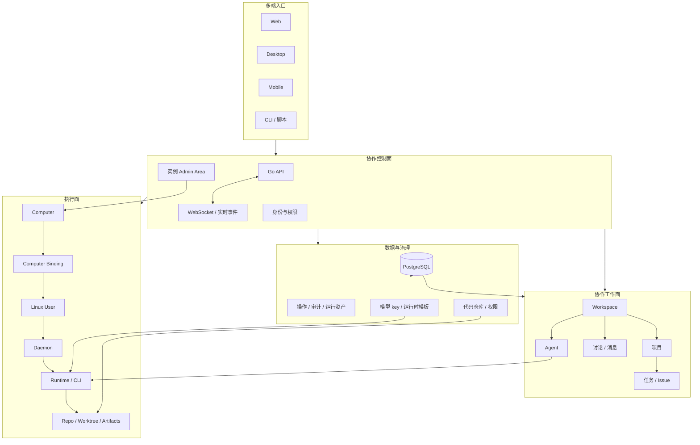
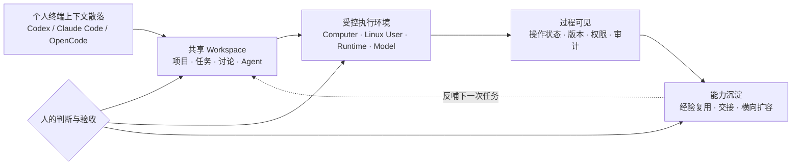

# AI 团队协作平台：产品方案与进展

> 供产品、研发、管理协作者及其 Agent 阅读。本文整理的是基于开源底座的定制化产品进展，重点回答“它解决什么组织问题、已经形成哪些能力、当前证据和边界是什么”。最终产品名称尚未确定，本文统一使用“AI 团队协作平台”指代产品主体。
>
> 证据基线（2026-10-29 刷新）：代码仓库 `trustbe-cn/multica` 的 `main`，HEAD `bc1ac307c`（本机 checkout `/home/tiger/bench/multica-sync`）；原定制分支 `feat/admin-area-computer-management`（`523cdac58`）已经合并到 main，同时又同步了两次开源上游（v0.6.4、v0.7.0）。自托管实例 `/home/tiger/bench/multica-deploy` 运行的也是 `bc1ac307c`。统计命令为 `git rev-list --count bc1ac307c --since='2026-09-22 00:00:00 +0800' --no-merges`，结果为 359 个非 merge 提交，其中 54 个由 `yunfeng` 完成。这个数比 10-20 版（190 / 45）大，主要是因为两次上游同步带进来 160 个开源社区提交，不代表自研工作量翻倍。10-20 版之后的变化见“五、7”和“八”。

## 产品背景与定位

本产品以开源项目 Multica 作为技术底座，最终产品名称尚未确定。产品方向是**AI 团队协作平台**：参考 Raft、Paperclip、OpenMeld、Buzz、Patchwork 等产品在团队协作、Agent 管理、项目组织和经验沉淀方面的思想，再结合公司实际研发、权限、服务器和模型资源场景做定制化建设。

产品主体不等同于开源底座。开源底座提供协作系统、客户端、服务端和扩展能力；定制化部分聚焦于公司的组织权限、代码托管、Computer/Linux User 执行环境、模型 key 分配、运行时治理和团队经验沉淀。

## 一、核心定位

本平台要做的是**AI 团队写作与研发协作平台**：把每个人原本留在 Codex、Claude Code、OpenCode 等本地工具里的对话、任务、代码操作和经验，沉淀到团队可访问的 Workspace、项目和运行记录中；同时把“谁能看什么代码、在哪台服务器上运行、使用哪个 Linux 账号、哪个 Agent、哪个模型 key”纳入统一的平台治理。

它的价值不是再做一个聊天窗口，而是给团队增加一层**可追踪的 AI 工作组织系统**：人和人可以协作，人和 Agent 可以协作，Agent 和 Agent 可以协作；过程有记录、结果有归属、执行环境可复用，成员离职后经验仍留在团队的 Workspace 和项目里。

## 二、要解决的现实问题

目前研发人员各自使用 Codex、Claude Code、OpenCode 等工具，主要问题有四类：

1. **经验留在个人机器上。** 对话、排障过程、提示词、任务上下文和决策理由没有进入团队资产，成员离职会带走大量隐性知识。
2. **工作过程难以复盘。** 管理者通常只能看到最终代码，不能连续看到任务如何拆分、谁和哪个 Agent 协作、失败如何恢复、哪些经验可复用。
3. **人和 Agent 缺少统一协作空间。** 人与人有聊天工具，Agent 有各自的本地会话，但两者没有共同的任务、讨论、权限和交接记录。
4. **AI 执行环境难治理。** 代码仓库权限、服务器账号、Linux 文件权限、CLI 安装、模型 API key、工作区成员权限分别管理，容易出现凭据混用、环境不可复现和离职后权限残留。

## 三、产品叙事：从“个人工具”到“团队 AI 生产系统”

可以用下面这条链路说明产品闭环：

```text
员工 / 管理者
    ↓
Workspace、项目、任务、讨论、Agent
    ↓
选择有权限的运行时和执行环境
    ↓
Computer → Linux User → Daemon → Runtime → CLI / 模型
    ↓
操作状态、版本、配置、审计、结果和经验沉淀
    ↓
团队复用、跨成员协作、管理者全局可见
```

其中，Workspace 和项目承载团队上下文；Agent 是可复用的协作者；Runtime 是执行能力；Computer、Linux User 和 Daemon 负责把执行能力落到真实主机；模型 key 和运行时模板负责让不同成员在有权限的前提下使用统一、可审计的模型配置。

## 四、系统架构视图

### 1. 源码和部署对应的四层结构



这张图表达的是模块边界和数据关系：协作对象由 Workspace、项目、任务、讨论和 Agent 组成；实例治理负责 Computer 与权限；执行链路落到 Linux User、Daemon 和 Runtime；数据库保存协作数据、权限、操作、资产和模型配置元数据。图中的连接表示产品契约，不表示每条链路都已经完成真实生产验收。

### 2. AI 时代团队协作新范式



这张图的重点是工作方式变化：个人仍然可以使用熟悉的 Coding Agent，但任务上下文进入共享空间；Agent 在有权限的执行环境中工作；人的判断、授权和验收保留在关键节点；过程、结果和失败恢复沉淀为团队可复用能力。

## 五、核心能力

### 1. 实例级 Admin Area：把基础设施管理从工作区权限中分离

管理员可以在工作区之外的 `/admin` 管理 Computer、连接检查、Linux User 绑定和审计。实例管理员身份由部署级配置控制，不由某个 Workspace 的 owner/admin 角色自动推导。

核心能力：

- 登记可通过 SSH 管理的 Computer，配置名称、地址、端口和 SSH operator。
- 保存前先做连接检查；连接检查结果和管理员操作写入审计。
- 管理 Computer 的启用、禁用、删除和已有绑定限制，避免在已有绑定时随意改指向。
- 管理员可以查看跨用户的绑定元数据和脱敏操作记录，但不因此获得用户的 Linux 密码、Git token、模型 key 或个人配置明文。
- 普通用户只看到自己可用的 Computer 摘要，主机地址、端口和 SSH operator 信息按权限隐藏。

产品表达：**平台开始具备“组织管理员管理执行基础设施”的能力，工作区协作权限与服务器治理权限被明确分层。**

证据：`80ba2c04c`、`ced0d9cc4`、`server/internal/handler/instance_admin.go`、`docs/design/computer-runtime-identity-model.md`。

### 2. 个人运行环境：每个成员拥有自己的 Linux 身份和执行边界

平台将几个容易混淆的概念拆开：

| 对象 | 产品含义 |
| --- | --- |
| Computer | 管理员登记的一台可通过 SSH 管理的主机 |
| Linux User | 主机上的真实 OS 账号，拥有自己的 home、文件权限和工具 |
| Computer Binding | 把 Computer、Linux User、平台用户和目标 Workspace 绑定起来 |
| Daemon | 以该 Linux User 身份运行，负责注册和执行运行时 |
| Runtime | Daemon 提供的一项可被 Agent 使用的执行能力 |
| Agent | Workspace 中可复用的协作者身份和配置 |

这套拆分带来三个组织价值：

- 同一台服务器可以服务多个成员，每个成员的 home、CLI、配置和守护进程互相隔离。
- 同一成员可以拥有多个 Computer/ Linux User 绑定，并把自己的执行环境接入不同 Workspace。
- Workspace owner/admin、实例管理员和 Linux User 所有者是不同权限域；管理 Workspace 不等于读取他人的服务器凭据，管理实例也不等于调用他人的私有 Agent。

工作区创建后的运行环境接入是可选步骤；可以跳过，之后再从 Workspace 或个人“我的 Linux 用户”入口接入。当前托管绑定本身仍然需要明确目标 Workspace，账号创建、凭据配置、CLI 安装和 Daemon 启动按不同阶段展示。

证据：`6cc04afaa`、`6b3cec2de`、`09c361db1`、`docs/design/computer-runtime-identity-model.md`、`docs/design/linux-user-workspace-collaboration-plan.md`。

### 3. 远程 Linux User 生命周期：从“能连上机器”到“可恢复的托管操作”

用户可以在平台里选择 Computer、输入 Linux 用户名和密码，创建或验证账号，再按需写入个人配置、安装 CLI、启动/升级 Daemon 或移除托管 Daemon。后端通过 SSH operator 切换到目标 UID 执行，客户端不能指定任意 home、任意 Linux 用户或任意 SSH 目标。

当前生命周期按事实分层：

- `pending`：账号已创建/验证，但还没有完成 Daemon 配置。
- `running`：有远端操作正在执行，互斥操作被阻止。
- `ready`：本次操作完成，并通过指定身份、Workspace、Daemon ID 和心跳的注册检查。
- `failed` / `interrupted`：保留失败或中断事实，用户从操作记录继续恢复，不能把“结果未知”误判成失败或成功。
- `removed` / `detached`：移除托管或解除 Workspace 关联；不自动等价于删除 Linux 账号和 home。

远端操作有持久化 operation ID、阶段、请求/实际版本、资产快照、完成时间和脱敏错误；服务重启后不会拿着明文密码自动重放未完成任务。账号占用、失败次数、密码不匹配锁定、同机同用户名唯一性和操作恢复均有数据库/文件锁及测试覆盖。

证据：`b528fd809`、`c3c761d45`、`server/migrations/540_*` 至 `545_*`、`docs/design/computer-remote-operations.md`、`docs/engineering/computer-runtime-acceptance.md`。

### 4. 统一安装和管理多种 AI Coding Runtime

管理员可以为用户侧 Linux User 安装和更新多种编程 Agent CLI，当前注册表覆盖 Claude、Codex、OpenCode、Pi、OMP、Kimi、Grok，并在产品模型上兼容 OpenClaw 的发现/配置场景。安装过程使用目标 Linux User 的用户目录和权限，保留用户已有配置；SSH operator 的交互式 shell、nvm 或其他账号环境不能冒充目标用户安装成功。

已形成的运维能力包括：

- 发现已安装版本并检查上游最新版本，区分“未安装、探测失败、无历史、确实无更新”。
- 单个运行时安装/升级，以及选中多个运行时的批量安装/更新；单项失败不应吞掉后续项。
- 下载集中经过平台服务端的缓存和受控下载能力，支持专用 HTTP/HTTPS/SOCKS5/SOCKS5H 出口代理，减少每个远端账号各自访问外网造成的不稳定。
- 缓存有大小、并发、TTL、哈希、临时文件清理和签名能力；下载 capability 绑定到具体运行操作，不能把服务变成任意 URL 代理。
- Admin Area 提供 Runtime cache 查看、刷新和清理入口；清理缓存不会卸载已安装 CLI。

产品表达：**平台开始统一管理“AI 工具链的安装、版本、网络出口和运行资产”，横向扩容不再靠每个人手工配置。**

证据：`72cfe0b39`、`d75d7d419`、`be1f56d1a`、`da182827e`、`4107e16e8`、`docs/engineering/runtime-cache.md`。

### 5. 模型 key、运行时模板与个人配置：把模型访问纳入组织治理

10 月 9 日版本增加了模型配置管理。实例管理员统一接入 sub2api，维护模型 key 目录、把 key 分配给具体平台用户，并维护各运行时的配置模板；用户在自己的 Linux User 详情中选择被分配且与运行时协议兼容的 key，选择模型，查看/编辑配置文件，保存并测试目标 CLI 的连接。

这个能力解决的是“模型账号各自散落、无法统一分配和轮换”的问题，同时保留个人隐私边界：

- 查询服务凭证由实例级加密配置保存，管理员输入后不回显。
- User-key 分配以平台用户为边界，其他 Workspace 成员不能因为共享运行时而读取配置明文。
- 模板只用于新建配置；管理员更新模板不会覆盖用户已编辑的文件。
- 模型 key 通过平台/协议兼容性筛选到适配的 CLI，不能仅凭 key 名称猜平台，也不能把未分配 key 透传给上游。
- 配置读取/保存/测试以绑定所有权、Linux 密码、目标 UID 和文件修订为条件；敏感草稿不落入浏览器持久化存储，操作日志不保存 token、密码和原始 CLI 输出。
- “检查配置”和“测试模型连接”分开；前者是静态检查，后者使用目标 Linux User 的真实 CLI、home 和配置执行最小请求，并把版本、模型、耗时和脱敏错误记录为操作结果。

首版支持八类受管 Linux User 运行时配置入口：Claude、Codex、OpenCode、OpenClaw、Grok、Kimi、OMP、Pi。

10 月 27 日起已经接上真实的密钥来源：天枢 sub2api（`.64`）的目录列表补齐了 platform、protocols 两个字段（在 #token_proxy task #230 中完成）。我们用自己的解析代码拉取完整目录，222 个 key 全部解析成功，没有令牌出现在目录里。按协议算，Claude 可用 108 个，Codex / Grok / OpenCode / Kimi 各 99 个，OpenClaw / OMP / Pi 各 207 个。另外 15 个 key 属于 gemini、grok、zhipu、deepseek 等暂不支持的平台（或平台为空），会显示但不能分配。10 月 29 日，自托管实例已用根地址配置好来源，同步了 222 个 key，并完成了首批 3 条用户分配。

产品表达：**平台开始把模型 API key 从个人私下配置，变成可分配、可撤销、可审计、按运行时隔离的组织资源。**

证据：`b7c9645c6`、`docs/design/runtime-model-configuration.md`、`docs/design/sub2api-key-directory-contract.md`、`docs/engineering/runtime-model-configuration-deployment.md`。

### 6. 从大表单转为资源管理界面

“我的运行环境”被拆成个人 Linux User 列表、账号详情、CLI Runtime、凭据和操作记录；Workspace Linux User 接入从个人资源管理中分出；Admin Area 保留 Computer、Linux User 和审计的实例视角。Web 与 Desktop 共享核心页面和状态契约，入口、返回路径和敏感状态清理按平台导航规则处理。

这体现了产品从“做一个能跑的配置表单”进入“长期管理资源”的阶段：用户可以先看列表和状态，再进入固定对象的详情执行操作，离开页面不会取消已经被服务端接受的远端任务。

证据：`73f02bfc2`、`17d6b18e4`、`6330aedc5`、`docs/design/management-page-hierarchy-plan.md`。

### 7. 10 月 20 日之后的进展：从“功能分支”变成“可持续维护的主线”

这段时间没有新增大功能，重点是把定制能力并入主线、跟住开源上游，并修复真实使用中暴露的问题。

**并入主线，持续跟进开源上游。** 定制分支已经合并进 `main`，此后又同步了两次开源上游，分别对应 v0.6.4（10-21，94 个提交）和 v0.7.0（10-26，66 个提交）。同步时，上游的数据库迁移号统一顺延到我们的号段之后，冲突逐个解决，定制功能没有丢。这说明“以开源项目为底座做定制”的模式可以长期维持：上游每次发版，我们都能在一两天内跟上。

**上游带来的可直接用的能力**（摘要）：
- 运行时可以只共享给指定成员。原来只有“私有 / 整个工作区”两档，现在多了“指定成员”。这正好补上了多人共用一个工作区时，按人授权执行资源的需求。
- 关联 PR 出现合并冲突时自动唤醒 Agent，任务失败时自动在 issue 下留言说明原因。
- 记录每次任务认领的判定结果，方便排查“任务为什么没被执行”。
- 若干 Agent CLI（Codex、Cursor、Hermes 等）的兼容性修复，以及看板、编辑器、桌面端的体验改进。

**真实使用中发现并修复的问题：**
- 中文系统下 Git 报错是中文，导致分支重名后无法自动重试。修复方法是让 daemon 调 Git 时固定用英文输出（`580a107b9`）。
- Admin 的“Linux 用户”页曾在 daemon 实际连不上服务器时仍显示“运行中”。现在新增“服务器连接”状态，按 runtime 最近 150 秒内有没有心跳判断在线 / 离线 / 未注册。工作区显示名称而不是 UUID；“检查账号”按钮不再互相锁死；页面内容超过一屏时可以滚动（`9c52e718b`、`bc1ac307c`）。
- 去掉产品内所有指向开源社区 Discord 的入口，产品不再引导用户去外部社区（`38fe3d0f8`、`cf4f13e6a`）。

**运维侧：** 自托管实例的对外端口从 3000 改到 3080，因为 3000 被同机 k8s 的 Grafana 占用。两个受管 Linux 用户的 daemon 配置已同步修改，48 个 runtime 恢复在线。每次部署前都会先完整备份数据库，并保留回滚用的配置。

证据：合并提交 `a21d984ba`、`148b83474`、`5128fca3e`；修复提交如上；`server/migrations/613_runtime_shared_with.up.sql`（指定成员共享，上游 #9455）。

## 六、把技术能力翻译成组织收益

| 技术能力 | 对团队的直接收益 | 对管理者的可见性 |
| --- | --- | --- |
| Workspace/项目/任务/讨论/Agent | 把人与 Agent 放到同一工作上下文 | 可按 Workspace、项目和任务查看进展与历史 |
| Computer + Linux User + Binding | 同机多成员隔离，环境可复用 | 能知道执行发生在哪台主机、哪个账号和哪个 Workspace |
| Daemon/Runtime 注册 | Agent 有明确执行能力和在线状态 | 能区分 CLI 已安装、Daemon 在线、Runtime 已注册和任务成功 |
| 持久化操作/资产/审计 | 失败可恢复，过程可追踪，不靠口头交接 | 能看操作阶段、错误摘要、版本和历史 |
| Runtime 缓存/代理/批量管理 | 降低重复安装和外网波动，支持横向扩容 | 能统一控制版本、出口和缓存容量 |
| 模型 key 分配/模板/连接测试 | 模型资源按人分配，配置可复用且可撤销 | 能管理 key 分配、模板修订和运行时兼容性 |
| Web/Desktop 共享入口 | 成员可按习惯使用不同客户端 | 产品行为和权限模型保持一致 |

最终希望形成的组织资产不是某个人的一段聊天记录，而是：**任务上下文 + 讨论过程 + Agent 配置 + 执行环境 + 代码变更 + 失败恢复 + 可复用经验**。

## 七、建议的产品讲解顺序（10 分钟）

1. **先讲痛点（1 分钟）：** 现在 AI 研发是个人工具，经验留在个人本地，无法形成团队资产。
2. **讲定位（1 分钟）：** AI 团队协作平台把人、Agent、Workspace、项目和执行环境放进一个可追踪闭环。
3. **讲协作层（2 分钟）：** Workspace、项目、任务、讨论和 Agent 让人↔人、人与 Agent、Agent↔Agent 有共同上下文。
4. **讲执行层（3 分钟）：** Admin Area、Computer、Linux User、Binding、Daemon、Runtime 解决权限、服务器和环境隔离；操作持久化使远端任务可恢复。
5. **讲规模化层（2 分钟）：** Runtime 版本/缓存/代理/批量安装，以及模型 key 分配和运行时模板，解决横向扩容和模型资源治理。
6. **讲证据与下一步（1 分钟）：** 代码、部署和自动化测试已形成基础闭环；下一步用专用非生产账号完成真实远端 CLI、模型和多成员验收，再进入更大范围试用。

## 八、当前证据：已部署、已测试和未完成要分开说明

### 已能确认的事实

以下事实于 2026-10-29 在现场复查。

- `main` HEAD 为 `bc1ac307c`；自托管实例镜像为 `multica-backend:bc1ac307c` / `multica-web:bc1ac307c`，与 main 一致。
- 现场检查：backend、frontend、PostgreSQL、gateway、runtime-proxy 均在运行，backend 和 frontend 为 healthy。
- `http://127.0.0.1:18000/health` 返回 `status=ok`、`commit=bc1ac307c`；`/healthz` 返回数据库和 migrations 均为 `ok`；入口 `http://10.10.0.31:3080/login` 返回 HTTP 200。数据库已应用 640 个迁移。
- 实例数据：3 个工作区、5 个用户、2 个受管 Linux 用户；runtime 48 个在线、2 个离线；模型密钥目录 222 项，用户分配 3 条。这仍是团队内部的小规模试用。
- 9 月 22 日后 main 共 359 个非 merge 提交，其中 54 个为 `yunfeng` 提交，约 160 个来自两次开源上游同步。自研主线仍集中在 Computer、个人 Linux User、运行时和模型配置。
- 多轮 Go race、前端 typecheck/lint、核心组件测试、迁移验证、部署健康检查和匿名鉴权检查已有记录。具体日志和部署快照位于 `/home/tiger/bench/multica-deploy/releases/`。

### 产品边界与验收状态

- 健康检查、匿名接口 401 和 UI/单元测试通过，不等于所有真实主机、所有 CLI 和所有模型都已完成端到端验收。
- 真实远端 Linux 账号、每一种 CLI 的真实安装/升级、Daemon 注册、GitLab 仓库操作和模型实际调用仍需要专用账号、测试仓库和明确授权逐项验收。
- 模型配置：真实 sub2api 目录已经接通，字段补全并解析通过（10-27）。八类 CLI 在目标版本下的兼容性，以及真实模型连接测试，仍需逐个验收。
- 工作区协作这一期还有 5 项验收没做完（`docs/engineering/linux-user-workspace-collaboration-todo.md`），主要是验证两人共用工作区时，各自的账号和凭据互相看不到。
- 治理上还缺两块，目前只停在设计讨论：一是 Git 凭据由系统按用户统一发放、可见、可收回（现在用的是每个 Linux 用户自己配的凭据）；二是每个 Agent 有独立的 Git 身份、提交署 Agent 名（现在只在提交说明里用 Co-authored-by 记一笔）。
- 当前 Computer/运行时能力是部署级自托管能力，不应表述为已经覆盖所有云电脑厂商、所有操作系统或所有企业网络环境。
- “经验沉淀”目前首先是 Workspace、项目、任务、讨论、操作历史和配置/执行记录的产品能力；自动把全部本地聊天内容转成高质量组织知识仍需要后续检索、总结和治理设计。

## 九、下一阶段建议

1. 用一台专用非生产 Computer 和两个测试平台用户，完成同机多账号、Workspace 隔离、权限拒绝、移除/重建和离职回收场景。
2. 为 Claude、Codex、OpenCode、Kimi、Grok、OMP、Pi、OpenClaw 分别准备可撤销测试 key，逐一完成安装、配置读取、模型连接和真实 Agent 运行验收。
3. 补齐管理员视角的数据报表：活跃 Workspace、Agent/Runtime 使用率、失败操作、模型用量、环境健康和权限变更。
4. 在真实试点团队中验证“过程沉淀是否真的减少交接成本”，重点观察新人接手、成员离职、跨项目复用和问题复盘四类场景。
5. 在产品层增加基于 Workspace/项目/任务/操作历史的助手 Agent，让管理者可以通过自然语言查看全局进展、风险和经验，而不是只看静态报表。
6. Git 凭据纳入平台治理：由系统按用户发放、保管和收回，能访问哪些仓库仍由 Git 平台管理；在此基础上可以给每个 Agent 一个独立 Git 身份，让提交直接署 Agent 名。
7. 保持每个开源上游版本发布后尽快同步，避免定制版与上游差距拉大。

## 十、中性产品表述

> 我们正在做的不是把几个 Coding Agent 再包装一层，而是把 AI 研发从个人工具升级为团队生产系统：每个人仍然可以使用自己熟悉的 Codex、Claude Code 或 OpenCode，但任务、上下文、权限、执行环境、模型资源和结果进入统一的 Workspace。这样既保留个人效率，又让过程可以协作、追踪、复盘和复用，逐步把个人经验变成公司的长期资产。

## 参考证据索引

- 产品/身份模型：`docs/design/computer-runtime-identity-model.md`
- 远端操作与恢复：`docs/design/computer-remote-operations.md`、`docs/engineering/computer-runtime-acceptance.md`
- Linux User 与 Workspace 协作：`docs/design/linux-user-workspace-collaboration-plan.md`、`docs/engineering/linux-user-workspace-binding-contract.md`
- 页面层级：`docs/design/management-page-hierarchy-plan.md`
- Runtime 缓存和代理：`docs/engineering/runtime-cache.md`
- 模型配置和权限：`docs/design/runtime-model-configuration.md`、`docs/design/sub2api-key-directory-contract.md`
- 模型配置部署：`docs/engineering/runtime-model-configuration-deployment.md`
- 部署现场：`/home/tiger/bench/multica-deploy/releases/*/DEPLOYMENT.md` 与对应 `verification.json`
- 主要提交：`6cc04afaa`、`80ba2c04c`、`72cfe0b39`、`b528fd809`、`73f02bfc2`、`6b3cec2de`、`be1f56d1a`、`da182827e`、`b7c9645c6`、`523cdac58`
- 10-20 之后：合并 `a21d984ba`（定制分支入 main）、`148b83474`（上游 v0.6.4）、`5128fca3e`（上游 v0.7.0）；修复 `580a107b9`、`9c52e718b`、`bc1ac307c`、`cf4f13e6a`
- 部署备份：`/home/tiger/bench/multica-deploy/backups/pre-5128fca-20261026T0732Z`、`pre-bc1ac307c-20261026T1432Z`
